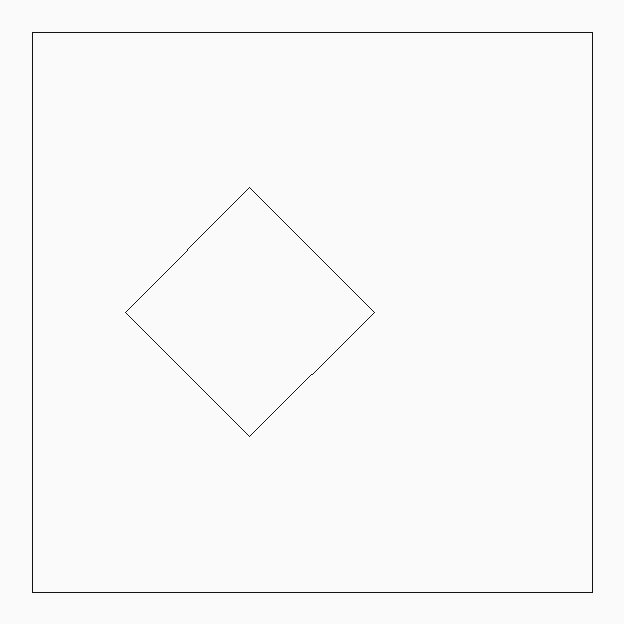
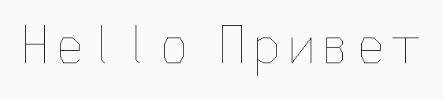
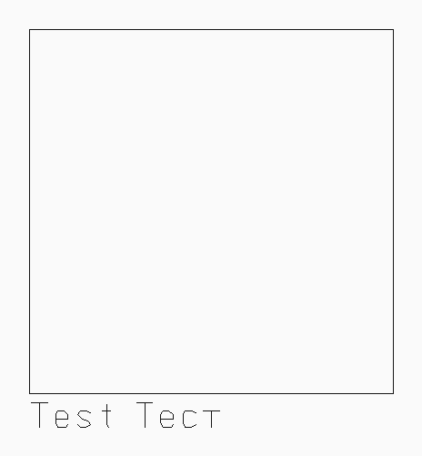

# grbl-pen-plotter

CLI tools for **GRBL pen plotters** — send G-code, convert SVG/text to toolpaths, dry-run previews, and keep the pen from crashing the sheet.

Built and calibrated against a **JinGan / BtWriter** 4-motor A4 handwriting machine (GRBL 1.3a, CH340 @ 115200). Other GRBL pen machines with Z-lift (or M3/M5 servo forks) can use a custom TOML profile.

## Features

- macOS/Linux **port autodetect** (`cu.usbserial*`, CH340)
- GRBL connect / soft-reset / status / jog / work-zero (`G92`)
- Safe **pen up/down** recipe (`M3` + `Z` down, `Z` up + `M5`) via profiles
- G-code **streaming** with `ok` flow control, pause/resume hooks, abort on alarm
- **SVG → G-code** (paths, polylines, fit to A4/A5/A6 + margins)
- **Text → G-code** with a single-line stick font (Latin + Cyrillic)
- **Dry-run preview** to SVG/PNG
- **Bounds check** against soft workspace limits
- **Stipple** from images — *experimental*
- pytest suite with a **fake GRBL** serial device; CI on macOS + Linux

## Install

```bash
python3 -m venv .venv
source .venv/bin/activate
pip install -e ".[dev]"
penplot --help
```

Requires Python 3.9+.

## Quickstart

```bash
# List / autodetect ports
penplot ports

# After parking at sheet corner with pen raised:
penplot zero
penplot status

# SVG → G-code + preview
penplot svg examples/square.svg -o /tmp/square.gcode --paper A5 --preview docs/images/square_preview.png

# Text (Latin + Cyrillic)
penplot text "Hello Привет" -o /tmp/hello.gcode --em 0.45 --preview docs/images/text_preview.png

# Bounds check + dry-run stream
penplot check /tmp/square.gcode
penplot stream /tmp/square.gcode --dry-run --preview /tmp/dry.png

# Live stream (plotter connected)
penplot stream /tmp/square.gcode --cool
```

Hardware smoke test (only if a plotter port exists):

```bash
penplot hwtest
```

## Supported hardware

| | |
|--|--|
| Tested class | JinGan 4-motor “BtWriter” GRBL 1.3a |
| Link | USB-serial CH340, typically `/dev/cu.usbserial-*` |
| Baud | 115200 |
| Pen | Stepper Z (+ optional `M3 S1000` hold); servo profiles possible |
| Homing | Often disabled (`$22=0`) — **you** set origin with `penplot zero` |

Vendor Windows apps / fonts are **not** included (unclear licensing). This repo is original MIT code plus an original stick alphabet for plotting.

## Safety

1. Park at the sheet corner with the pen at **max height**, then `penplot zero`.
2. Keep **`$32=0`** (laser mode off).
3. Do **not** enable GRBL `$20` soft limits without homing.
4. While plotting use **`$1=255`** so the pen holds; cool with **`$1=25`** after (`--cool`).
5. Soft-reset clears `G92` — re-zero every session.
6. Streams abort on `ALARM` and attempt pen-up.

See [docs/TROUBLESHOOTING.md](docs/TROUBLESHOOTING.md).

## Preview examples

<p>
  
  
  
</p>

## Docs

- [Configuration](docs/CONFIGURATION.md)
- [G-code dialect](docs/GCODE_DIALECT.md)
- [Troubleshooting](docs/TROUBLESHOOTING.md)
- [Hardware test checklist](docs/HARDWARE_TEST.md)

## Experimental

`penplot stipple` — weighted random dots + nearest-neighbor / light 2-opt ordering. Dense hops can look like “worms” instead of clean stipple; tune lift threshold and Z depth, or prefer line SVG/handwriting.

## License

MIT — see [LICENSE](LICENSE). Stick font: original single-stroke geometry (not vendor fonts).
